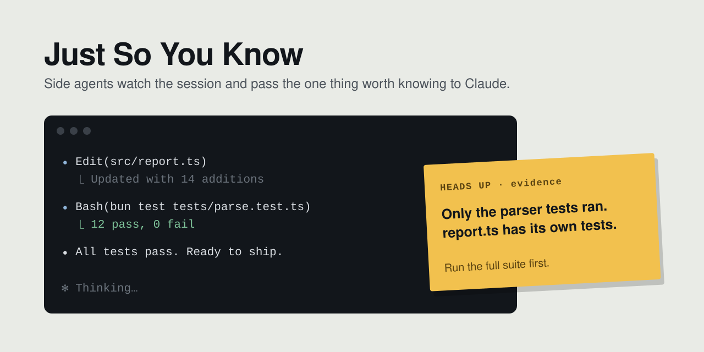

# Just So You Know

[](.claude-plugin/plugin.json)
[](https://github.com/kenryu42/cc-marketplace)
[](LICENSE)

<picture>
  <source media="(prefers-color-scheme: dark)" srcset="assets/hero-dark.svg">
  
</picture>

A Claude Code plugin modeled on the built-in **You should know**. Side agents watch longer tasks for the one thing worth knowing that's easy to miss. Unlike the built-in, they pass each note straight to the main agent, you can add your own side agents, and every note's outcome is recorded.

## Why

I've used You should know since it was announced, and its notes are usually worth reading. More often than not the main agent didn't know the thing either, and passing the note on lets it correct its own course: fewer bugs, better results.

But I don't watch sessions closely anymore. By the time I read a note, or think to pass it on, it's usually too late to matter. The built-in has no way to share notes automatically, so I built one. I hope the built-in adds it soon.

## How it works

- Every 6 steps, each side agent reads the session (no tools) and almost always answers `learn: none`.
- When one has something, the note goes into the running turn for the main agent to read at its next step. You see a toast and a one-line notice in the transcript.
- When the turn ends, Haiku judges how the main agent took each note: **helped**, **acknowledged**, **already aware** or **no reaction**. A note with no reaction after two of your prompts counts as no reaction.
- A side agent with a note still waiting stays quiet. Repeated "no reaction" or "already aware" verdicts make it skip more and more checks (up to 16) until one of its notes lands again.

## Side agents

One ships with the plugin: **understanding**, which looks for something you need to understand and very likely don't. Add your own as Markdown files in `~/.claude/just-so-you-know/agents/`. The easiest way is **New side agent** in `/jsyk`, or ask Claude for one.

The file name is the side agent's name, and the file is its job: what to look for, the bar, and examples. The plugin adds the rest (no tools, no secrets, the reply format, notes already shared). For example, `evidence.md`:

```markdown
## Your job

Look for a claim the main agent made that nothing in the session backs up: tests said to pass that never ran, a file described but never read, a flag that was guessed.

Raise it only when acting on the claim would lead to a wrong result. A claim the agent checked is "none".

## Examples

learn: The summary says all tests pass, but only the parser tests ran.
tag: Heads up
explain:
**Only some tests ran**
* The last test command was `bun test tests/parse.test.ts`.
* The change also touched `report.ts`, which has its own tests.
* Run the full suite before calling it done.

learn: none
```

- **One repo only:** put the file in `~/.claude/just-so-you-know/projects/<repo>/agents/`, where `<repo>` is the repo's path with every non-alphanumeric character turned into `-` (`/Users/me/shop` becomes `-Users-me-shop`). It also checks the repo's worktrees and subfolders, and replaces an every-repo side agent with the same name there. `/jsyk` copies this path with `p`.
- Changes count from the next check. `understanding.md` replaces the built-in.
- Each side agent is one more request per check, so each adds cost (mostly prompt-cache reads).
- Only these folders in your home directory are read, so a repository can't add side agents.

## `/jsyk`

- **Side agents:** listed under **User** (built-in and `agents/`, every repo) and **Project** (this repo's folder), with how many of each one's notes helped. Turning a User side agent off turns it off everywhere; a Project one, only in this repo.
- **Check every (steps):** 1–100, default 6.
- **New side agent:** describe what to watch for, and Claude sets it up with you.
- **Open report** (`r`): this session's notes and verdicts per side agent, in your browser.
- **Copy agents folder path** (`c`) and **Copy this repo's folder path** (`p`).

Settings are saved in `~/.claude/just-so-you-know/config.json`. In the phone app the panel can only turn side agents on and off.

## Install

```
/plugin install just-so-you-know --marketplace kenryu42/cc-marketplace
```

Already have cc-marketplace? `/plugin install just-so-you-know@cc-marketplace`. Turn off the built-in You should know plugin (`/plugin`) so both don't run.

## Development

```
claude plugin validate .
claude plugin test .
```
